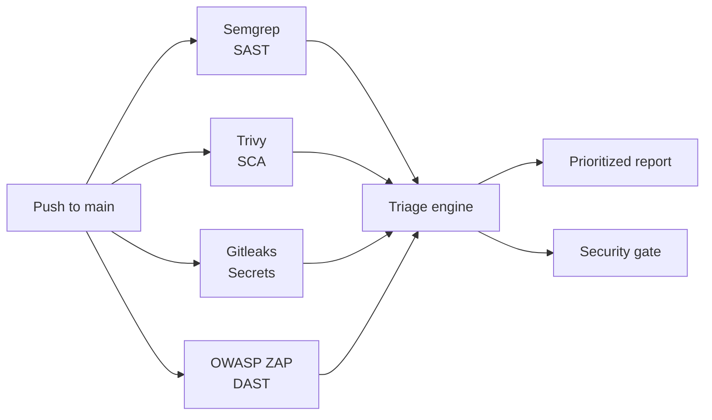

# Vulnerability Triage Pipeline


A DevSecOps pipeline that runs four security scanners on every push, then
uses a custom Python triage engine to turn hundreds of raw findings into a
short, prioritized fix list.

Scanners are good at finding problems and bad at ranking them. This project
focuses on the ranking: which findings are duplicates, which are likely
false positives, and which are most likely to be exploited.

## How it works



The scan target is [OWASP Juice Shop](https://github.com/juice-shop/juice-shop),
a deliberately vulnerable web application.

| Stage | Tool | What it checks |
|---|---|---|
| SAST | Semgrep | Source code, for insecure patterns |
| SCA | Trivy | The container image, for libraries with known CVEs |
| Secrets | Gitleaks | The full git history, for hardcoded credentials |
| DAST | OWASP ZAP | The running application, from the outside |

## The triage engine

`triage.py` and `enrich.py` do five things:

1. **Normalize.** Convert four different report formats into one schema.
2. **Deduplicate.** Merge repeats, such as one secret found in many commits.
3. **Enrich.** Look up every CVE in EPSS (exploit probability) and the
   CISA Known Exploited Vulnerabilities catalog.
4. **Score.** Give each finding a risk score from 0 to 100.
5. **Gate.** Fail the build if any finding is priority P1.

### Risk score

| Factor | Points |
|---|---|
| Severity | Up to 40 |
| EPSS exploit probability | Up to 40 |
| Listed in CISA KEV | 20 |
| Hardcoded secret | 25 |
| Located in test code | Minus 30 |

| Priority | Rule | Action |
|---|---|---|
| P1 | In CISA KEV, or score 70 and above | Fix now, build fails |
| P2 | Score 50 to 69 | Fix this sprint |
| P3 | Score 30 to 49 | Schedule |
| P4 | Below 30 | Backlog |

Secrets found in test code are scored lower because they are usually dummy
values that never reach production.

## Results

From a scan of OWASP Juice Shop in November 2026:

| Metric | Value |
|---|---|
| Unique findings after deduplication | 229 |
| CVEs enriched with EPSS scores | 84 |
| Findings in CISA KEV | 0 |
| P2, fix this sprint | 11 |
| P3, schedule | 48 |
| P4, backlog | 170 |

The engine reduced 229 findings to 11 that need attention this sprint.
See [report.md](report.md) for sample output.

## Run it locally

Requires Python 3.12 or later. No extra packages are needed.

```
py triage.py sample-reports
py enrich.py
```

`sample-reports` must contain `semgrep.json`, `trivy.json`, `gitleaks.json`
and `zap.json`. Download them from the artifacts of any pipeline run.

## Roadmap

- AI-drafted remediation guidance for the top findings
- Allowlist for known false positives, such as public identifiers flagged as secrets
- Upload findings to the GitHub Security tab in SARIF format
- Pin scanner versions and actions to fixed releases

## Tech

GitHub Actions, Python, Docker, Semgrep, Trivy, Gitleaks, OWASP ZAP,
FIRST EPSS API, CISA KEV catalog.